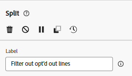
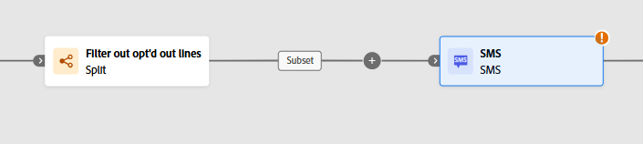

# Zeilen filtern

## Ziel

In den nächsten Schritten werden Sie alle Zeilen herausfiltern, die aufgrund ihrer Abmeldung auf Zeilenebene tatsächlich nicht mit einer SMS-Nachricht angesprochen werden dürfen.  Sie können sich hier nicht auf die Profilzustimmung verlassen, da dies ein Ziel auf Zeilenebene ist.

## Aufspaltungsaktivität einrichten

1. Klicken Sie auf das Symbol **+** in der unteren Transition der Aktivität Verzweigung und wählen Sie im Popup die Aktivität **Aufspaltung** aus.

   

2. Aktualisieren Sie in der rechten Leiste die Bezeichnung , sodass sie Folgendes angibt: `Filter out opt'd out lines`

   

3. Erweitern Sie in der rechten Leiste den Abschnitt **Standardsegment** und klicken Sie auf die Schaltfläche **Filter erstellen**

   

4. Fügen Sie eine Bedingung hinzu, um sicherzustellen, dass Sie alle Kundenzeilen entfernen, die vom SMS-Messaging abgemeldet wurden, und klicken Sie dann auf **Bestätigen**.

   

   >[!NOTE]
   >
   >Sie müssen herausfinden, wie Sie die Bedingung erstellen, aber das Endergebnis stimmt mit dem obigen Screenshot überein.  Du hast das!

5. Klicken Sie auf die Schaltfläche Speichern oben rechts, um Ihre Arbeit zu speichern.  Ihre Arbeitsfläche sieht nun wie folgt aus\…

## Hinzufügen der SMS-Aktivität

1. Klicken Sie auf der Workflow-Arbeitsfläche auf das Symbol **+** nach der hinzugefügten Bedingung für die Aufspaltung und wählen Sie die **Aktivität für mobile Nachrichten**

   

   

2. Klicken Sie in der rechten Leiste auf die Schaltfläche Mobile-Nachricht bearbeiten , um mit der Konfiguration der SMS-Nachricht zu beginnen

   

3. Klicken Sie in der oberen Navigationsleiste auf das Menüelement Aktionen und wählen Sie dann aus der Dropdown-Liste Mobile-Nachrichtenkonfiguration den zuvor erstellten Kanal aus.

## Zusammenfassung

Sie haben alle Zeilen herausgefiltert, die aufgrund des Opt-outs nicht mit einer SMS-Nachricht angesprochen werden durften, und eine SMS-Aktivität für diejenigen hinzugefügt, die angesprochen werden durften.
